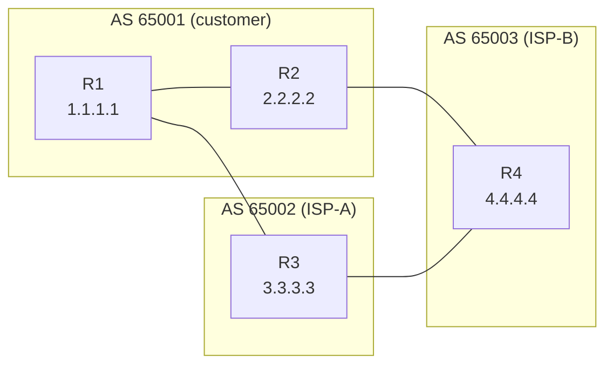

# BGP Lab: Multi-AS Design, Failover Test and Network Automation

A four-router BGP lab built in GNS3 (Cisco IOSv), with an Ansible role to deploy the BGP configuration and a pyATS test suite to validate it. A customer AS is dual-homed to two ISPs, with path control, route filtering and a failover test.

## Topology



| Link | Subnet | Addresses |
|---|---|---|
| R1 - R2 | 10.0.12.0/30 | R1 .1, R2 .2 |
| R1 - R3 | 10.0.13.0/30 | R1 .1, R3 .2 |
| R2 - R4 | 10.0.24.0/30 | R2 .1, R4 .2 |
| R3 - R4 | 10.0.34.0/30 | R3 .1, R4 .2 |

| Router | AS | Loopback0 | Advertised prefix |
|---|---|---|---|
| R1 | 65001 | 1.1.1.1/32 | 192.168.10.0/24 |
| R2 | 65001 | 2.2.2.2/32 | 192.168.20.0/24 |
| R3 | 65002 | 3.3.3.3/32 | 172.16.30.0/24 |
| R4 | 65003 | 4.4.4.4/32 | 172.16.40.0/24 |

## What the lab covers

1. **Underlay:** OSPF area 0 between R1 and R2 so the iBGP session can run between loopbacks.
2. **eBGP:** R1-R3, R2-R4 and R3-R4 sessions between directly connected interfaces.
3. **iBGP:** R1-R2 with `update-source Loopback0` and `next-hop-self`, so ISP next hops are reachable inside AS 65001.
4. **Outbound path control:** local preference 200 on routes learned from R3 (route-map `PREFER-ISPA`), so AS 65001 prefers ISP-A.
5. **Inbound path control:** AS-path prepending (`65001 65001`) toward R4 (route-map `TO-ISPB`), so other ASes prefer the path through ISP-A.
6. **Not a transit AS:** a prefix-list (`CUSTOMER`) and route-maps allow only the customer's own prefixes to be advertised to the ISPs.
7. **Failover test:** continuous ping while shutting the R1-R3 link.

## Failover result

With the R1-R3 link shut, 71 pings were lost before traffic moved to the R2 path. The likely cause is that BGP waited for the hold timer (180 seconds by default) instead of reacting immediately.

Next step: lower the BGP timers or add BFD, repeat the test and compare the loss.

## Repository layout

```
router_bgp_config/        Final running configs for R1-R4 (banners removed)
ansible_bgp_configuration/
    deploy.yaml           Playbook
    bgp_config.j2         Jinja2 template for the BGP section
    host_vars/            Per-router variables (R1-R4)
    group_vars/routers.yaml  Connection settings (credentials from environment variables)
    hosts.ini             Inventory
pyATS_bgp_validation/
    testbed.yaml          Device connection details
    test_bgp.py           Neighbor and route validation
    bgp_job.py            Job file for `pyats run job`
```

## Management network (needed for automation)

Ansible and pyATS run from an Ubuntu control host and reach the routers over SSH:

- A management switch connects GigabitEthernet0/2 of R1 to R4.
- Each router has a management address on Gi0/2, `ip ssh version 2`, a local user and `login local` on the VTY lines.
- Static routes on the routers point to the Ubuntu host's network so replies return. Management addresses are not advertised in BGP or OSPF.
- Addresses: R1 `192.168.100.11`, R2 `192.168.100.12`, R3 `192.168.100.13`, R4 `192.168.100.14`, control host `192.168.134.129`.

Example of the lines added to each router (see the `.cfg` files for the exact values):

```
ip domain-name lab.local
username <user> privilege 15 secret <password>
crypto key generate rsa modulus 2048
ip ssh version 2
interface GigabitEthernet0/2
 ip address <mgmt-ip> <mask>
 no shutdown
ip route <ubuntu-network> <mask> <next-hop>
line vty 0 4
 login local
 transport input ssh
```

## Running the automation

Ansible deploys the BGP section of the configuration. The interfaces, OSPF underlay and routing policies are in `router_bgp_config/`.

```bash
pip install ansible
ansible-galaxy collection install cisco.ios ansible.netcommon
export ANSIBLE_USER=<user> ANSIBLE_PASS=<password>
cd ansible_bgp_configuration
ansible-playbook deploy.yaml --check --diff   # preview changes
ansible-playbook deploy.yaml
```

pyATS then checks that every expected neighbor is Established with the right AS, and that each router has the expected BGP routes.

```bash
pip install "pyats[full]"
export PYATS_USERNAME=<user> PYATS_PASSWORD=<password>
cd pyATS_bgp_validation
python test_bgp.py                                   
pyats run job bgp_job.py --testbed-file testbed.yaml  
```

Run the playbook twice: the second run should report `changed=0` on every router (idempotent). Use `--diff` to see which line keeps changing if it does not.

## Status

- [x] Lab built and configured through the failover test
- [ ] Ansible deployment tested end to end
- [ ] pyATS validation tested end to end
- [ ] Break-and-fix troubleshooting scenarios

## What I learned

- Why iBGP needs `next-hop-self` when the next hop is an eBGP neighbor outside the AS.
- How local preference and AS-path prepending control outbound and inbound traffic differently.
- Why a customer AS must filter what it advertises to avoid becoming a transit network.
- Why BGP failover is slow with default timers.
