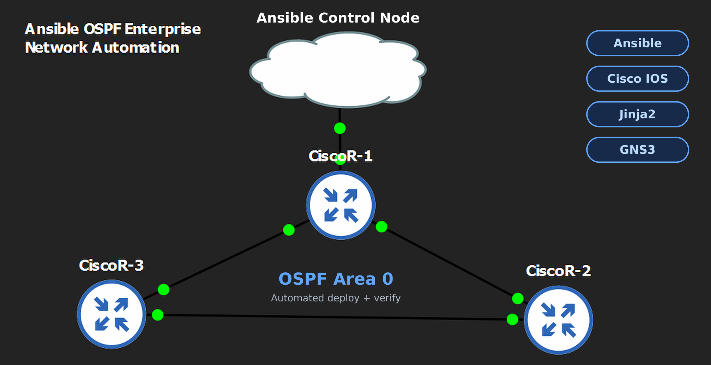

# Network Automation

A collection of network automation projects built with Ansible, pyATS, Python and Cisco IOS, tested in GNS3 lab environments.

## Projects

## Projects

| Project | What it does | Tools |
|---|---|---|
| [Ansible OSPF Enterprise Network Automation](ansible-ospf-automation) | Automated multi-router OSPF deployment and verification using Ansible roles, host variables and Jinja2 templates | Ansible, Jinja2, Cisco IOS, GNS3, YAML |
| [pyATS Network Validation](network_validation_pyATS) | Validates a 3-router OSPF lab against expected state kept in YAML: connectivity, interfaces, OSPF neighbors, routing table and end-to-end pings | pyATS, Genie, Python, YAML, Cisco IOS |
| [BGP Lab: Enterprise Network Automation](BGP_lab) | iBGP full mesh across four routers, deployed with Ansible and validated with pyATS. A management switch connects the routers to an Ubuntu control host over SSH. The second Ansible run reports `changed=0` and the pyATS run passes | Ansible, Jinja2, pyATS, Cisco IOS, GNS3, BGP |

More projects will be added here as I build them.

## About me

I'm Goodness Bakinde, an early-career network engineer focused on enterprise networking and network automation.

- Certification: Netacad Cisco CCNA and CCNA Automation
- Currently studying: CCNP ENCOR (350-401)
- Skills: Cisco IOS, OSPF, BGP, EIGRP, VLANs, Python, Ansible, pyATS, Jinja2, Linux, GNS3

Connect with me on [LinkedIn](https://www.linkedin.com/in/goodness-bakinde).
